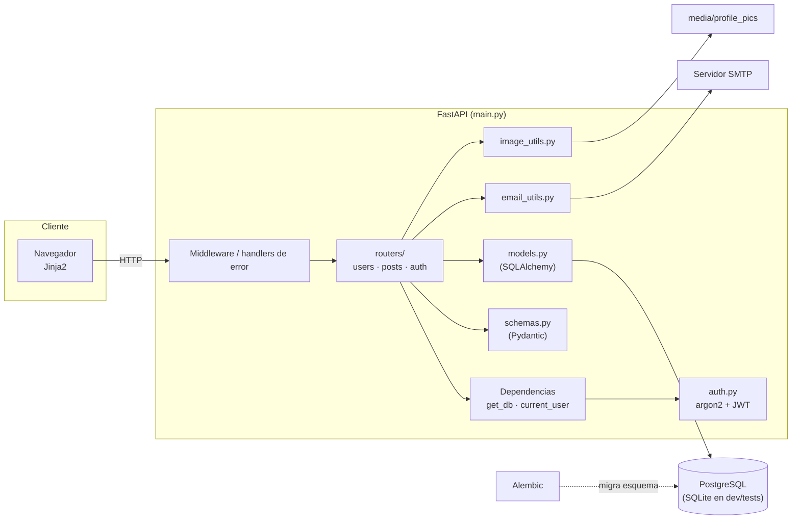
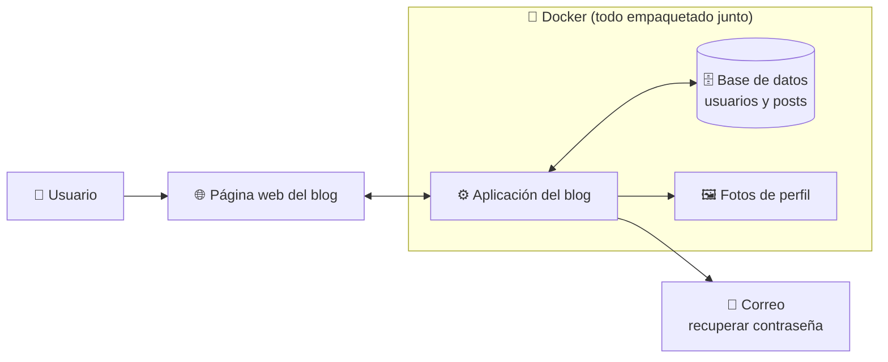
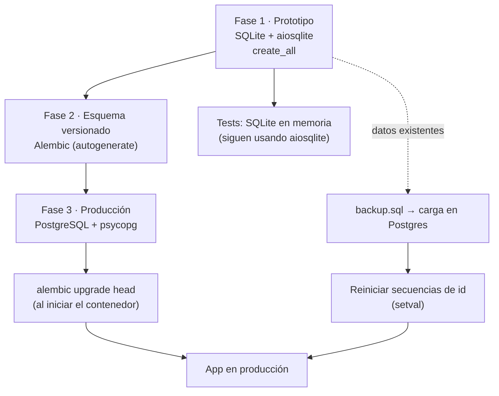
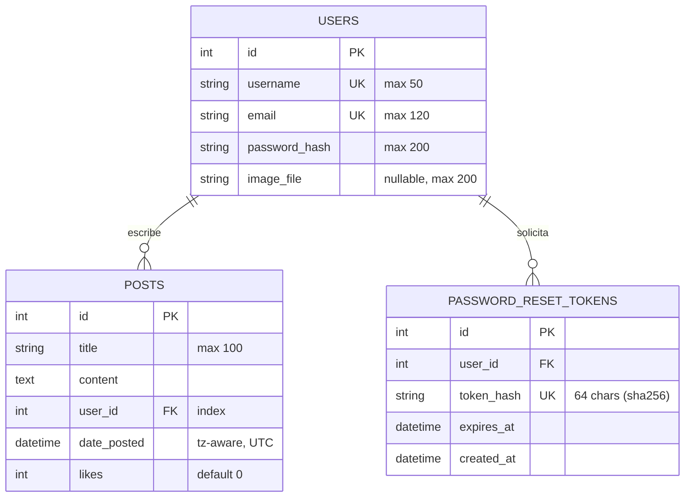
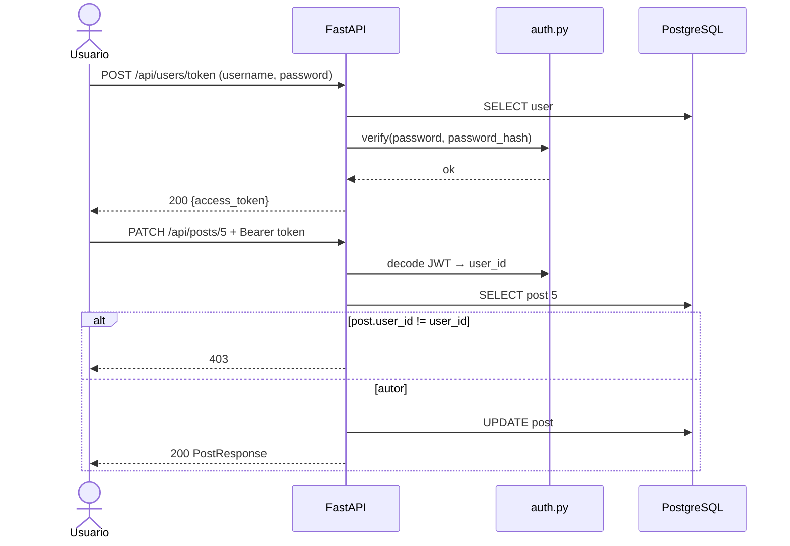
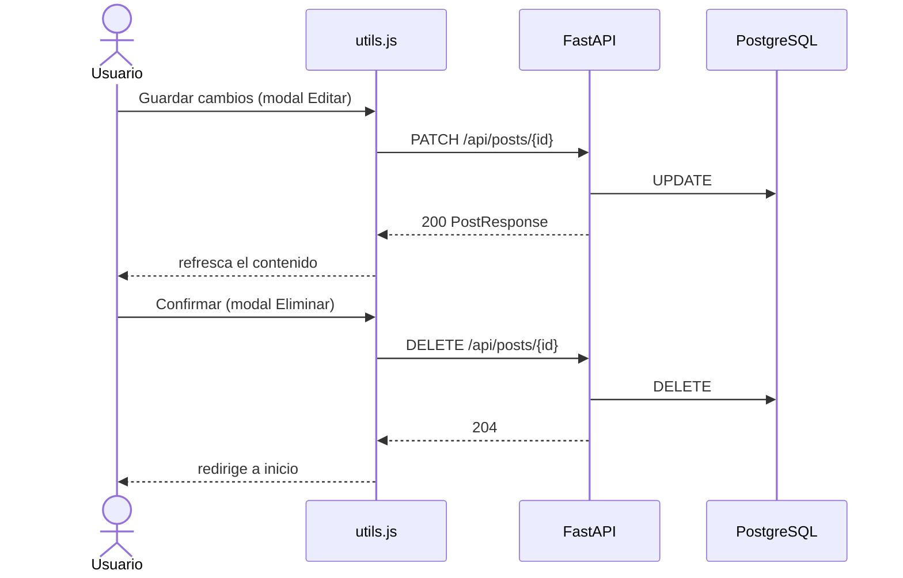
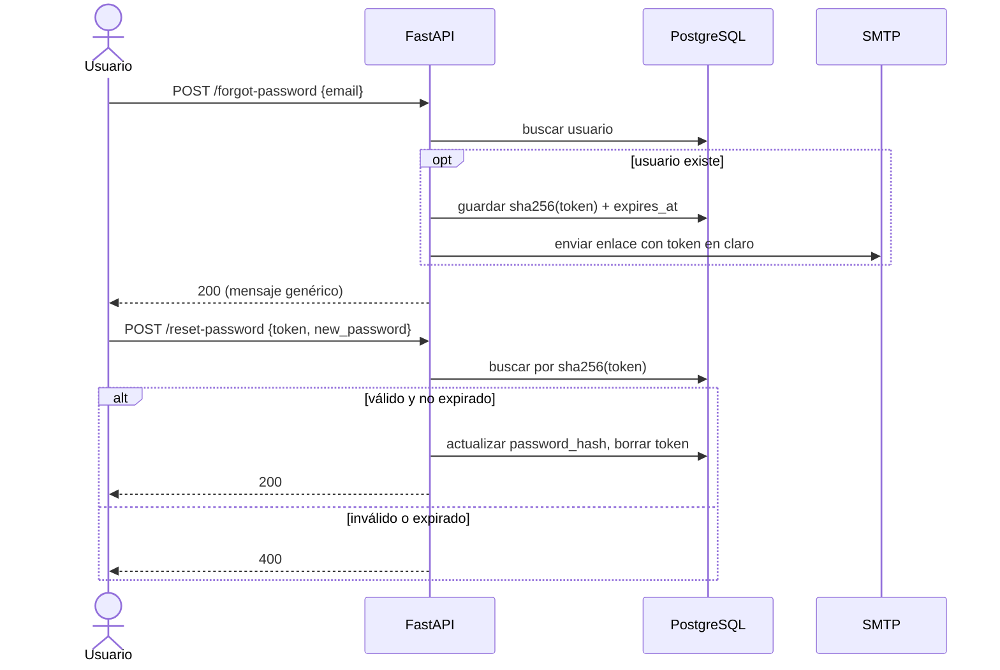
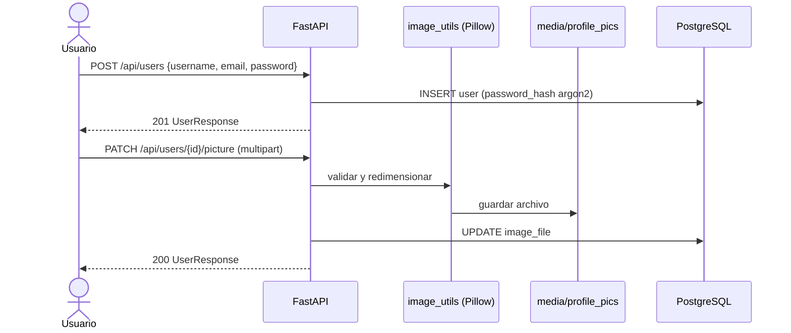

# Diseño de la API  — blog_fastapi

## 1. Stack tecnológico y el porqué de cada pieza

| Librería | Rol | Por qué se eligió | Alternativa descartada |
|---|---|---|---|
| **Python ≥ 3.13 + uv** | Runtime y gestor de entorno | `uv` resuelve y bloquea dependencias (`uv.lock`) de forma rápida y reproducible; un solo comando para entorno, scripts y build | pip + requirements.txt (sin lock real), Poetry |
| **FastAPI[standard]** | Framework web | Async nativo, validación con type hints, OpenAPI y `/docs` gratis (el contrato se vuelve ejecutable); el extra `standard` trae uvicorn y las utilidades de desarrollo | Flask (sin validación ni async nativos), Django (más pesado para una API + plantillas pequeñas) |
| **Pydantic v2** (vía FastAPI) | Schemas de entrada/salida (`schemas.py`) | Separa el contrato público del modelo de base de datos: nunca se expone `password_hash` | Devolver modelos SQLAlchemy directamente |
| **pydantic-settings** | Configuración (`config.py`) | Variables de entorno tipadas y validadas al arrancar; misma app en local, Docker y producción sin tocar código | `os.environ` suelto, `python-dotenv` en producción |
| **SQLAlchemy 2.x (asyncio)** | ORM (`models.py`, `database.py`) | `Mapped[]` tipado, sesiones async que no bloquean el event loop, mismo código sobre SQLite y PostgreSQL | SQL a mano, Tortoise/SQLModel |
| **aiosqlite** | Driver SQLite async | Desarrollo inicial y tests sin levantar servicios | — |
| **psycopg[binary] 3** | Driver PostgreSQL | Driver moderno con soporte async; `binary` evita compilar libpq | asyncpg, psycopg2 (sin async) |
| **Alembic** | Migraciones (`alembic/`) | El esquema deja de depender de `create_all`: queda versionado y se puede reproducir en Postgres desde cero (ver sección 3) | `Base.metadata.create_all` (no migra cambios) |
| **pwdlib[argon2]** | Hash de contraseñas (`auth.py`) | Argon2 es el algoritmo recomendado actualmente; `pwdlib` es la opción vigente frente a `passlib`, que quedó sin mantenimiento | bcrypt con passlib, SHA256 (inaceptable) |
| **PyJWT** | Tokens de acceso | Autenticación sin estado para la API; librería pequeña y mantenida | python-jose, sesiones en servidor |
| **aiosmtplib** | Envío de correo (`email_utils.py`) | SMTP async: enviar el correo de reset no bloquea otras peticiones | smtplib síncrono, servicios con SDK propio |
| **Pillow** | Imágenes (`image_utils.py`) | Validar, recortar y redimensionar fotos de perfil antes de guardarlas | Guardar el archivo tal cual (riesgo de peso y de archivos no-imagen) |
| **pytest** | Tests | Estándar, fixtures para override de dependencias (BD de prueba) | unittest |
| **moto[s3]** (dev) | Simular S3 en tests | Permite probar almacenamiento de objetos sin cuenta AWS. ⚠ Confirmar si hoy se usa S3 o disco (`media/profile_pics`) y registrarlo en un ADR | — |
| **Jinja2 + Bootstrap + fetch** | Frontend servido por FastAPI | Sin build de JS: páginas HTML renderizadas en servidor y modales que llaman a la API con `fetch` | SPA con React (más infraestructura para este alcance) |
| **Docker / compose** | Empaquetado | Mismo entorno local y producción; compose levanta app + PostgreSQL | — |

---

## 2. Arquitectura




```


**Reglas de dependencia** (lo que se debe respetar al programar):

1. Los routers dependen de `schemas`, `models`, `auth` y utilidades; **nunca al revés**.
2. `models.py` no importa nada de `routers` ni de `schemas`.
3. Toda ruta obtiene la sesión por `Depends(get_db)` y el usuario por `Depends(current_user)`; no se crean sesiones dentro de la función.
4. La autorización (¿es el autor?) se verifica en el router, la autenticación (¿quién eres?) en la dependencia.

---

## 3. Evolución de la base de datos: SQLite → PostgreSQL con Alembic



**Por qué Alembic fue la pieza clave del cambio:**

- Con SQLite, `create_all` bastaba, pero no modifica tablas existentes. Alembic convierte cada cambio de modelo (por ejemplo, `likes` con `server_default="0"`) en una revisión reproducible.
- La misma cadena de migraciones construye el esquema en Postgres desde cero: la fuente de verdad es `alembic/versions/`, no el estado de un archivo `.db`.
- `alembic.ini` + `env.py` deben leer la URL desde `config.py`, para que cambiar de motor sea cambiar una variable de entorno.

**Diferencias SQLite ↔ PostgreSQL a vigilar (checklist de la migración):**

| Tema | SQLite | PostgreSQL | Efecto en este proyecto |
|---|---|---|---|
| Longitud de `String(n)` | No se aplica | Se aplica | `title` (100), `username` (50), `email` (120) pueden fallar con datos que antes pasaban |
| Zona horaria en `DateTime(timezone=True)` | Se ignora | Se respeta (`timestamptz`) | `date_posted` y `expires_at` se guardan en UTC de forma consistente |
| Autoincrement | Implícito | Secuencias | Tras cargar `backup.sql`, reiniciar secuencias de `users.id`, `posts.id`, `password_reset_tokens.id` |
| `ALTER TABLE` | Limitado | Completo | En SQLite Alembic necesita `render_as_batch=True`; en Postgres no |
| Mayúsculas/minúsculas en `unique` | Según collation | Sensible a mayúsculas | `username`/`email` duplicados por mayúsculas: normalizar a minúsculas al guardar |

---

## 4. Modelo de datos



Reglas de negocio:

- Borrar un usuario elimina en cascada sus posts y sus tokens (`cascade="all, delete-orphan"`).
- Del token de reset solo se guarda el **hash**; el valor en claro viaja únicamente por correo.
- Si `image_file` es `NULL`, se usa la imagen por defecto.

---

## 5. Contrato de la API

### 5.1 Convenciones

| Tema | Decisión |
|---|---|
| Prefijo | `/api` para JSON. Las páginas HTML (Jinja2) quedan fuera de este contrato |
| Autenticación | `Authorization: Bearer <JWT>` |
| Formato de error | `{"detail": "mensaje"}`; en `422` FastAPI devuelve la lista de errores de Pydantic |
| Paginación | `?skip=0&limit=20` (límite máximo a definir) |
| Fechas | ISO 8601 en UTC |
| Códigos | 200 lectura/edición · 201 creación · 204 borrado · 400 regla de negocio · 401 sin/ mal token · 403 sin permiso · 404 no existe · 409 conflicto · 422 validación |

### 5.2 Resumen de endpoints

| Estado | Método | Ruta | Auth | Descripción |
|---|---|---|---|---|
| ⚠ | POST | `/api/users` | público | Registro de usuario |
| ⚠ | POST | `/api/users/token` | público | Login, devuelve JWT |
| ⚠ | GET | `/api/users/me` | 🔒 | Usuario autenticado |
| ⚠ | GET | `/api/users/{user_id}` | público | Perfil público |
| ⚠ | PATCH | `/api/users/{user_id}` | 🔒 propio | Editar username/email |
| ⚠ | PATCH | `/api/users/{user_id}/picture` | 🔒 propio | Subir foto de perfil |
| ⚠ | DELETE | `/api/users/{user_id}` | 🔒 propio | Eliminar cuenta (cascada) |
| ⚠ | GET | `/api/users/{user_id}/posts` | público | Posts de un usuario |
| ⚠ | POST | `/api/users/forgot-password` | público | Solicitar reset por correo |
| ⚠ | POST | `/api/users/reset-password` | público | Fijar nueva contraseña con token |
| ⚠ | GET | `/api/posts` | público | Listar posts (paginado) |
| ⚠ | POST | `/api/posts` | 🔒 | Crear post |
| ⚠ | GET | `/api/posts/{post_id}` | público | Detalle de post |
| ✅ en uso | PATCH | `/api/posts/{post_id}` | 🔒 autor | Editar post (modal Editar) |
| ✅ en uso | DELETE | `/api/posts/{post_id}` | 🔒 autor | Eliminar post (modal Eliminar) |
| ⚠ | POST | `/api/posts/{post_id}/like` | 🔒 | Sumar like (la columna `likes` existe; definir si se permite un like por usuario) |

### 5.3 Detalle de los endpoints principales

#### POST `/api/users/token`
- **Propósito:** autenticar y entregar un JWT.
- **Body:** formulario OAuth2 (`username`, `password`) — `application/x-www-form-urlencoded`.
- **Lógica:** buscar usuario → verificar hash Argon2 → firmar JWT con `sub=user.id` y `exp`.
- **Respuestas:**

| Código | Cuándo | Body |
|---|---|---|
| 200 | Credenciales válidas | `{"access_token": "...", "token_type": "bearer"}` |
| 401 | Usuario o clave incorrectos (mismo mensaje en ambos casos) | `{"detail": "..."}` |
| 422 | Formulario incompleto | errores Pydantic |

#### POST `/api/posts`
- **Auth:** 🔒 JWT. **Body (`PostCreate`):** `title` (1–100), `content` (≥1).
- **Efecto:** crea el post con `user_id` del token (nunca del body) y `date_posted` en UTC.

| Código | Cuándo | Body |
|---|---|---|
| 201 | Creado | `PostResponse` |
| 401 | Sin token o inválido | `{"detail": "..."}` |
| 422 | Título > 100 o vacío | errores Pydantic |

#### PATCH `/api/posts/{post_id}`
- **Auth:** 🔒 JWT + el usuario debe ser el autor.
- **Body (`PostUpdate`):** `title?` (1–100), `content?`. Los campos ausentes no se modifican.

| Código | Cuándo | Body |
|---|---|---|
| 200 | Actualizado | `PostResponse` |
| 401 | Token ausente o inválido | `{"detail": "..."}` |
| 403 | El usuario no es el autor | `{"detail": "..."}` |
| 404 | El post no existe | `{"detail": "..."}` |
| 422 | Validación | errores Pydantic |

#### DELETE `/api/posts/{post_id}`
- **Auth:** 🔒 JWT + autor. **Efecto:** elimina el post.

| Código | Cuándo |
|---|---|
| 204 | Eliminado (sin body) |
| 401 / 403 / 404 | Igual que PATCH |

#### POST `/api/users/forgot-password`
- **Body:** `{"email": "..."}`.
- **Regla de seguridad:** responde **siempre 200 con el mismo mensaje**, exista o no el correo (evita enumeración de usuarios).
- **Efecto:** genera token aleatorio, guarda `sha256(token)` con `expires_at`, envía el enlace por SMTP.

#### POST `/api/users/reset-password`
- **Body:** `{"token": "...", "new_password": "..."}`.
- **Efecto:** valida hash y expiración, actualiza `password_hash`, elimina el token (uso único).

| Código | Cuándo |
|---|---|
| 200 | Contraseña actualizada |
| 400 | Token inválido o expirado |
| 422 | Contraseña no cumple política |

---

## 6. Flujos principales

### 6.1 Login y acceso a un recurso protegido



### 6.2 Editar y eliminar desde la página (fetch)



### 6.3 Recuperación de contraseña



### 6.4 Registro con foto de perfil



---

## 7. Seguridad y calidad (criterios de aceptación)

- Contraseñas: solo hash Argon2; nunca se registran en logs ni se devuelven.
- JWT con expiración corta y clave en variable de entorno (`config.py`), no en el repo.
- Autorización por recurso: toda edición o borrado comprueba que el usuario sea el autor.
- Subida de imágenes: validar tipo real, límite de tamaño y nombre de archivo generado por el servidor.
- Respuestas de `forgot-password` indistinguibles entre correo existente y no existente.
- Tests mínimos por endpoint: caso feliz, 401, 403, 404 y 422.
- Base de datos de pruebas aislada (SQLite en memoria) con `dependency_overrides[get_db]`.

## 8. ADRs pendientes de redactar

| # | Decisión |
|---|---|
| 0001 | FastAPI async frente a Flask/Django |
| 0002 | JWT sin estado frente a sesiones |
| 0003 | Argon2 con pwdlib |
| 0004 | Guardar solo el hash del token de reset |
| 0005 | SQLite en desarrollo y tests, PostgreSQL en producción, migraciones con Alembic |
| 0006 | Imágenes: disco local frente a S3 |
| 0007 | Estructura del código: módulos en raíz frente a `src/fastapi_blog` |
