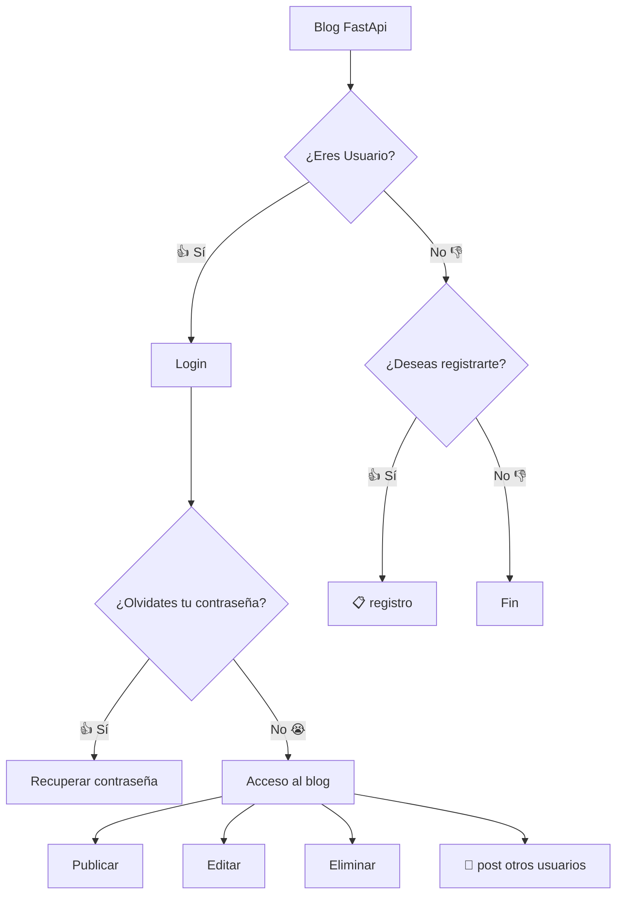

# Requisitos de la aplicación

Diseñar y desarrollar una API para un blog, donde: 

1. Un usuario pueda registrarse usando correo y contraseña.
2. Un usuario pueda modificar su perfil y eliminarlo.
3. Un usuario pueda restablecer su contraseña en caso haya perdido u olvidado.
3. Un usuario pueda hacer publicaciones, editarlas y eliminarlas. 

### Boseto Básico de la API a desarrollar.

