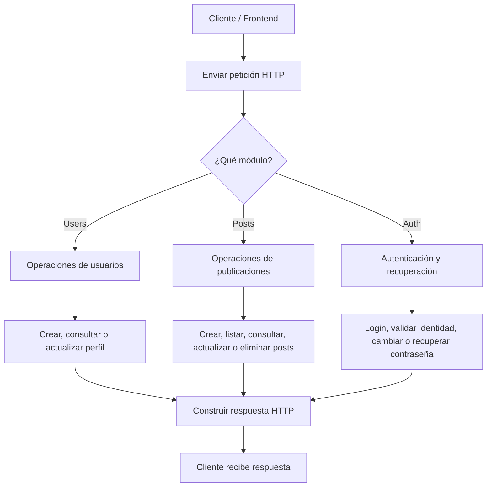
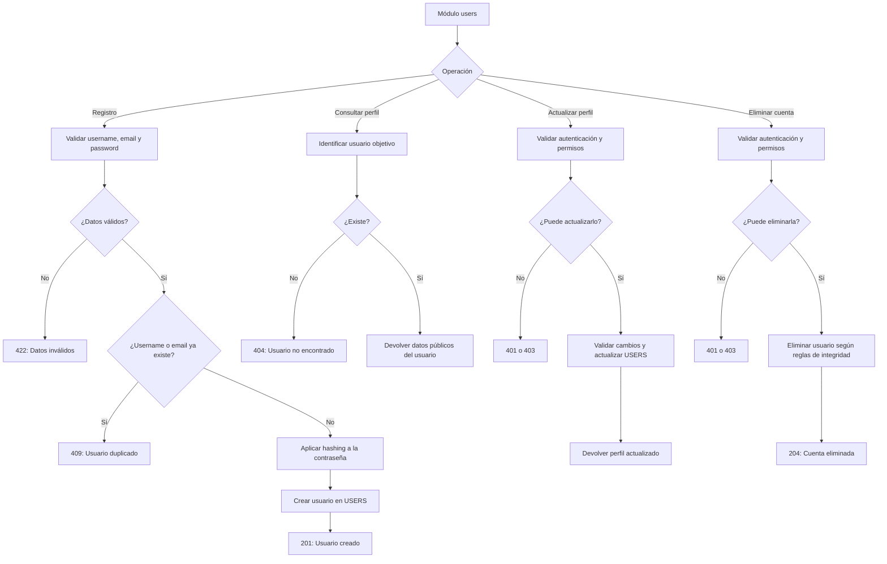
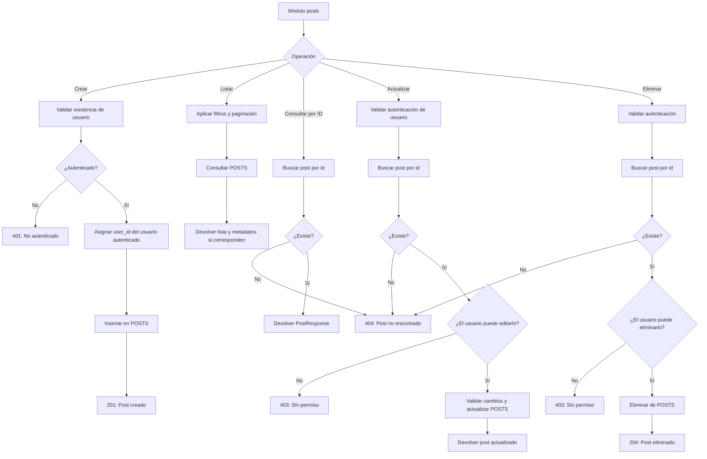
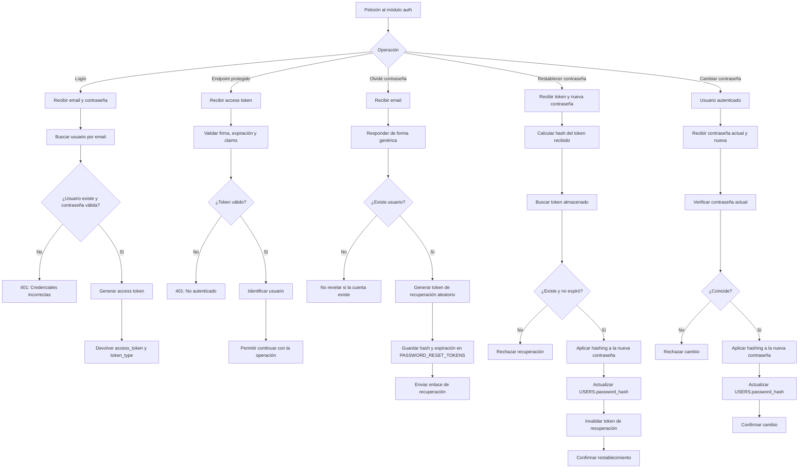

# Diseño API

## Users

## Posts

## Auth

## SCHEMAS

### USERS

- UserBase(BaseModel)
    - username
    - email

- UserCreate(UserBase)
    - password

- UserPublic(ORMModel)
    - id
    - username
    - image

- UserPrivate(UserPublic)
    - email

- UserUpdate
    - username
    - email

### AUTH

- Token(BaseModel)
    - access_token
    - token_type

- ForgotPasswordRequest(BaseModel):
    - email

- ResetPasswordRequest(BaseModel)
    - token
    - new_password

- ChangePasswordRequest(BaseModel):
    - current_password
    - new_password

### POSTS

- PostBase(BaseModel)
    - title
    - content

- PostCreate(PostBase)
   
- PostResponse(PostBase, ORMModel)
    - id
    - user_id 
    - date_posts
    - author:UserPublic

- PostUpdate(BaseModel)

- PaginatedResponse(BaseModel)
    - list[PostResponse]
    - total
    - skip
    - limit
    - has_more

## Services 

### Posts

- get_posts
- get_posts_by_id
- create_post
- update_post
- update_post_partial
- delete_post

### Users
Consultas
- get_user_by_id
- get_user_by_email
- get_user_by_username

Registro
- create_user

Autenticación
- authenticate_user
- create_user_token

Recuperación de contraseña
- create_password_reset
- reset_user_password
- change_user_password

Publicaciones de un usuario
- get_user_posts

Actualizar perfil
- update_user
- delete_user

Foto de perfil
- update_profile_picture
- delete_profile_picture

## Catálogo de endpoints

| Método HTTP   | Endpoint                      | Objetivo                              | Acceso                        |          
|---            |---                            |---                                    |---                            |
| POST          | `/api/users`                  | Registrar un usuario                  | Público                       | 
| GET           | `/api/users/me`               | Consultar mi perfil                   | Autenticado                   |
| PATCH         | `/api/users/me`               | Actualizar mi perfil                  | Autenticado                   |
| PATCH         | `/api/users/me/picture`       | Actualizar mi foto de perfil          | Autenticado                   |
| POST          | `/api/users/token`            | Iniciar sesión y obtener un token     | Público                       |
| POST          | `/api/users/forgot-password`  | Solicitar recuperación de contraseña  | Público                       |
| POST          | `/api/users/reset-password`   | Restablecer contraseña                | Token de recuperación válido  |
| GET           | `/api/posts`                  | Listar publicaciones                  | Público                       |
| POST          | `/api/posts`                  | Crear una publicación                 | Autenticado                   |
| GET           | `/api/posts/{post_id}`        | Consultar una publicación             | Público                       |
| PATCH         | `/api/posts/{post_id}`        | Actualizar una publicación            | Autor autorizado              |
| DELETE        | `/api/posts/{post_id}`        | Eliminar una publicación              | Autor autorizado              |