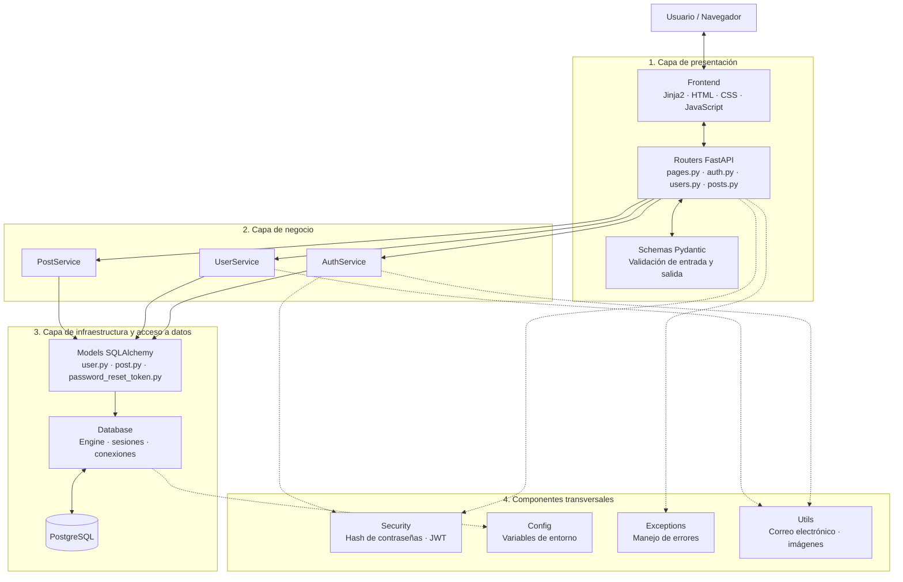

# Arquitectura por capas de la API

### Stack tecnológico

- **Lenguaje:** Python 3.13
- **Backend:** FastAPI, Uvicorn
- **Base de datos:** PostgreSQL 17
- **ORM y migraciones:** SQLAlchemy, Alembic
- **Frontend:** HTML5, CSS3, JavaScript, Jinja2
- **Contenedores:** Docker, Docker Compose
- **Gestión de dependencias:** uv
- **Validación de datos:** Pydantic
- **Autenticación:** OAuth2, JWT, pwdlib
- **Testing:** pytest, HTTPX, AnyIO

