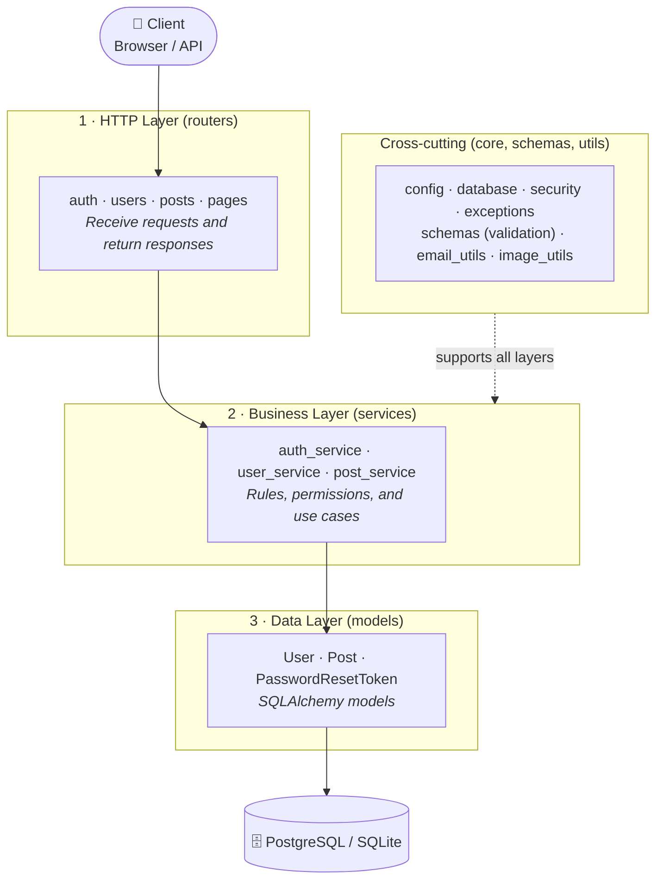

# FastAPI Blog

Asynchronous REST API for a blog, built with **FastAPI** and organized into layers (routers → services → models). Includes JWT authentication, email-based password recovery, profile image management, and a lightweight server-rendered frontend with Jinja2.

## Objectives

- Build a maintainable asynchronous REST API with clearly separated responsibilities.
- Implement secure authentication and authorization: JWT, Argon2 password hashing, and account recovery without information leakage.
- Ensure a versioned and portable database schema (PostgreSQL or SQLite).
- Provide a consistent API contract: strict validation, uniform pagination, and predictable errors.

## Achievements

**Architecture**

- Layer separation: `routers` (HTTP only), `services` (business logic and data access), and `core` (configuration, database, security, and exceptions).
- Centralized domain errors (`AppError` and subclasses): services are independent of HTTP, and a single handler translates them into JSON under `/api` or an error page on the frontend.
- Typed and validated configuration with `pydantic-settings` (secrets as `SecretStr`), with no sensitive values hardcoded.

**Security**

- JWT Bearer login (OAuth2 Password Flow) and Argon2 password hashing.
- Password recovery with a single-use token, stored only as a hash, with expiration and background email delivery.
- Responses that do not reveal whether an email exists (login and *forgot password*).
- Resource-level authorization: only the author can edit or delete their posts, and each user can only modify their own account.
- Case-insensitive uniqueness for `username` and `email`.

**Data and Performance**

- Asynchronous SQLAlchemy 2 with `selectinload` to avoid N+1 queries when loading authors.
- Reusable pagination (`skip`, `limit`, `has_more`) for the general listing and each user's posts.
- Migrations with Alembic.

**Functionality and Quality**

- Profile picture uploads with size and format validation (JPEG, PNG, GIF, WebP) and image processing with Pillow outside the event loop; the previous image is deleted when replaced.
- Automated tests with pytest for users and posts.
- Reproducible environment with `uv` and containerization with Docker.

## Stack

- Python 3.13+, FastAPI, Pydantic v2 / pydantic-settings
- SQLAlchemy 2 (async) + Alembic
- PostgreSQL (`psycopg`) or SQLite (`aiosqlite`)
- PyJWT + Argon2 (pwdlib)
- Pillow (profile images), aiosmtplib (recovery emails)
- Tools: uv, pytest, Docker

## Architecture



- **Routers:** receive requests, inject dependencies (`DbSession`, `CurrentUser`), and delegate to a service. They contain no business logic.
- **Services:** validate rules, query and persist data, and raise domain exceptions. One-way dependencies: `auth_service → user_service → post_service`.
- **Core:** shared infrastructure (configuration, async engine and session, security utilities, and error hierarchy).

## Quick Start

```bash
uv sync

cp .env.example .env      # then edit the values (see Configuration)
alembic upgrade head
fastapi dev app/backend/main.py
```

- App: http://localhost:8000
- Interactive API documentation: http://localhost:8000/docs

With Docker:

```bash
docker compose up --build
```

## Configuration (`.env`)

| Variable | Default | Description |
|---|---|---|
| `DATABASE_URL` | – (required) | SQLAlchemy async URL |
| `SECRET_KEY` | – (required) | JWT signing key |
| `ALGORITHM` | `HS256` | JWT algorithm |
| `ACCESS_TOKEN_EXPIRE_MINUTES` | `30` | Access token lifetime |
| `RESET_TOKEN_EXPIRE_MINUTES` | `60` | Password recovery token lifetime |
| `POSTS_PER_PAGE` | `10` | Default page size |
| `MAX_UPLOAD_SIZE_BYTES` | `5242880` | Maximum profile image size (5 MB) |
| `MAIL_SERVER` / `MAIL_PORT` | `localhost` / `587` | SMTP server |
| `MAIL_USERNAME` / `MAIL_PASSWORD` | – | SMTP credentials |
| `MAIL_FROM` / `MAIL_USE_TLS` | `noreply@example.com` / `true` | Sender and TLS |
| `FRONTEND_URL` | `http://localhost:8000` | Base URL for recovery links |

## API

**Authentication:** send `Authorization: Bearer <access_token>` to protected routes. The complete interactive reference is available at `/docs`.

### Auth — `/api/users`

| Method | Route | Access | Description |
|---|---|---|---|
| `POST` | `/token` | Public | Login (the form's `username` field is the email) |
| `POST` | `/forgot-password` | Public | Requests a recovery email |
| `POST` | `/reset-password` | Public | Resets the password using the received token |
| `PATCH` | `/me/password` | Bearer | Changes the authenticated user's password |

### Users — `/api/users`

| Method | Route | Access | Description |
|---|---|---|---|
| `POST` | `/` | Public | Registration |
| `GET` | `/me` | Bearer | Authenticated user's profile |
| `GET` | `/{user_id}` | Public | Public profile |
| `GET` | `/{user_id}/posts` | Public | User's posts (paginated) |
| `PATCH` | `/{user_id}` | Bearer (own account) | Updates user information or email |
| `DELETE` | `/{user_id}` | Bearer (own account) | Deletes the account |
| `PATCH` | `/{user_id}/picture` | Bearer (own account) | Uploads the profile picture |
| `DELETE` | `/{user_id}/picture` | Bearer (own account) | Deletes the profile picture |

### Posts — `/api/posts`

| Method | Route | Access | Description |
|---|---|---|---|
| `GET` | `/` | Public | Paginated listing (`skip`, `limit`) |
| `POST` | `/` | Bearer | Creates a post |
| `GET` | `/{post_id}` | Public | Post details |
| `PUT` | `/{post_id}` | Bearer (author) | Full replacement |
| `PATCH` | `/{post_id}` | Bearer (author) | Partial update |
| `DELETE` | `/{post_id}` | Bearer (author) | Deletes the post |

**Paginated response:** `{ posts, total, skip, limit, has_more }`

**Errors:** `/api/*` returns JSON `{"detail": ...}` with status codes `400`, `401`, `403`, `404`, or `422` (validation).

## Data Model

- **User** — `username` (unique), `email` (unique), `password_hash`, `image_file`
- **Post** — `title` (≤100), `content`, `user_id` → User, `date_posted`, `likes`
- **PasswordResetToken** — hashed token with expiration, associated with User

Relationships: User 1—N Post; User 1—N PasswordResetToken (cascade deletion).

## Project Structure

```text
.
├── alembic/                 Migrations
├── app/
│   ├── backend/
│   │   ├── main.py          App, routers, and global error handling
│   │   ├── core/            config, database, security, exceptions
│   │   ├── routers/         HTTP layer: auth, users, posts, pages
│   │   ├── services/        auth_service, user_service, post_service
│   │   ├── models/          SQLAlchemy models
│   │   ├── schemas/         Pydantic schemas
│   │   ├── utils/           email_utils, image_utils
│   │   ├── tests/           pytest tests
│   │   └── populate_db.py   Sample data
│   └── frontend/            Jinja2 templates, static files, and media
├── Docs/                    Requirements, data model, API design, architecture
├── compose.yml
├── dockerfile
└── pyproject.toml
```

## Frontend

Server-side rendering with Jinja2 (templates) and static assets (CSS/JS); uploaded images are served from `/media`.

## Tests

```bash
uv run pytest
```

## Additional Documentation

- [`Docs/1.requirements.md`](Docs/1.requirements.md): requirements
- [`Docs/2.database_model.md`](Docs/2.database_model.md): data model
- [`Docs/3.api_design.md`](Docs/3.api_design.md): API design
- [`Docs/architecture_stack.md`](Docs/architecture_stack.md): architecture and tech stack

## Next Steps

- Rate-limit attempts on `/token` and `/forgot-password`.
- Delete the profile picture from disk when deleting a user.