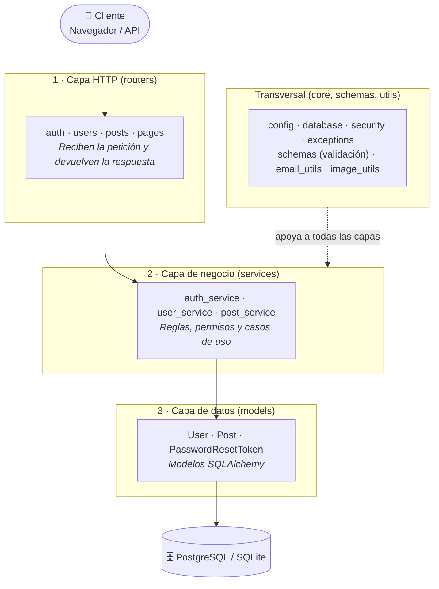

# FastAPI Blog

API REST asíncrona para un blog, construida con **FastAPI** y organizada en capas (routers → services → models). Incluye autenticación JWT, recuperación de contraseña por correo, gestión de imágenes de perfil y un frontend ligero renderizado en servidor con Jinja2.

## Objetivos

- Construir una API REST asíncrona, mantenible y con responsabilidades claramente separadas.
- Implementar autenticación y autorización seguras: JWT, contraseñas con Argon2 y recuperación de acceso sin filtrar información.
- Garantizar un esquema de base de datos versionado y portable (PostgreSQL o SQLite).
- Ofrecer un contrato de API consistente: validación estricta, paginación uniforme y errores predecibles.

## Logros

**Arquitectura**
- Separación en capas: `routers` (solo HTTP), `services` (lógica de negocio y acceso a datos) y `core` (configuración, base de datos, seguridad y excepciones).
- Errores de dominio centralizados (`AppError` y subclases): los services no conocen HTTP, y un único handler los traduce a JSON en `/api` o a una página de error en el frontend.
- Configuración tipada y validada con `pydantic-settings` (secretos como `SecretStr`), sin valores sensibles en el código.

**Seguridad**
- Login con JWT Bearer (OAuth2 Password Flow) y hash de contraseñas con Argon2.
- Recuperación de contraseña con token de un solo uso, almacenado únicamente como hash, con expiración y envío de correo en segundo plano.
- Respuestas que no revelan si un email existe (login y *forgot password*).
- Autorización por recurso: solo el autor puede editar o eliminar sus posts, y cada usuario solo puede modificar su propia cuenta.
- Unicidad de `username` y `email` sin distinguir mayúsculas.

**Datos y rendimiento**
- SQLAlchemy 2 asíncrono con `selectinload` para evitar consultas N+1 al cargar autores.
- Paginación reutilizable (`skip`, `limit`, `has_more`) en el listado general y en los posts de cada usuario.
- Migraciones con Alembic.

**Funcionalidad y calidad**
- Subida de foto de perfil con validación de tamaño y formato (JPEG, PNG, GIF, WebP) y procesamiento con Pillow fuera del event loop; la imagen anterior se elimina al reemplazarla.
- Pruebas automatizadas con pytest para usuarios y posts.
- Entorno reproducible con `uv` y contenedorización con Docker.

## Stack

- Python 3.13+, FastAPI, Pydantic v2 / pydantic-settings
- SQLAlchemy 2 (async) + Alembic
- PostgreSQL (`psycopg`) o SQLite (`aiosqlite`)
- PyJWT + Argon2 (pwdlib)
- Pillow (imágenes de perfil), aiosmtplib (correos de recuperación)
- Herramientas: uv, pytest, Docker

## Arquitectura



```

- **Routers:** reciben la petición, inyectan dependencias (`DbSession`, `CurrentUser`) y delegan en un service. No contienen lógica de negocio.
- **Services:** validan reglas, consultan y persisten, y lanzan excepciones de dominio. Dependencias en un solo sentido: `auth_service → user_service → post_service`.
- **Core:** infraestructura compartida (configuración, motor y sesión async, utilidades de seguridad, jerarquía de errores).

## Inicio rápido

```bash
uv sync
cp .env.example .env      # luego edita los valores (ver Configuración)
alembic upgrade head
fastapi dev app/backend/main.py
```

- App: http://localhost:8000
- Documentación interactiva de la API: http://localhost:8000/docs

Con Docker:

```bash
docker compose up --build
```

## Configuración (`.env`)

| Variable                          | Por defecto                       | Descripción                               |
|---                                |---                                |---                                        |
| `DATABASE_URL`                    | – (obligatoria)                   | URL async de SQLAlchemy                   |
| `SECRET_KEY`                      | – (obligatoria)                   | Clave de firma JWT                        |
| `ALGORITHM`                       | `HS256`                           | Algoritmo JWT                             |
| `ACCESS_TOKEN_EXPIRE_MINUTES`     | `30`                              | Duración del token de acceso              |
| `RESET_TOKEN_EXPIRE_MINUTES`      | `60`                              | Duración del token de recuperación        |
| `POSTS_PER_PAGE`                  | `10`                              | Tamaño de página por defecto              |
| `MAX_UPLOAD_SIZE_BYTES`           | `5242880`                         | Tamaño máx. de imagen de perfil (5 MB)    |
| `MAIL_SERVER` / `MAIL_PORT`       | `localhost` / `587`               | Servidor SMTP                             |
| `MAIL_USERNAME` / `MAIL_PASSWORD` | –                                 | Credenciales SMTP                         |
| `MAIL_FROM` / `MAIL_USE_TLS`      | `noreply@example.com` / `true`    | Remitente y TLS                           |
| `FRONTEND_URL`                    | `http://localhost:8000`           | URL base para enlaces de recuperación     |

## API

**Autenticación:** enviar `Authorization: Bearer <access_token>` en las rutas protegidas. Referencia interactiva completa en `/docs`.

### Auth — `/api/users`

| Método    | Ruta                  | Acceso    | Descripción                                               |
|---        |---                    |---        |---                                                        |
| `POST`    | `/token`              | Público   | Login (el campo `username` del formulario es el email)    |
| `POST`    | `/forgot-password`    | Público   | Solicita el correo de recuperación                        |
| `POST`    | `/reset-password`     | Público   | Restablece la contraseña con el token recibido            |
| `PATCH`   | `/me/password`        | Bearer    | Cambia la contraseña del usuario autenticado              |

### Usuarios — `/api/users`

| Método    | Ruta                  | Acceso            | Descripción                       |
|---        |---                    |---                |---                                |
| `POST`    | `/`                   | Público           | Registro                          |
| `GET`     | `/me`                 | Bearer            | Perfil del usuario autenticado    |
| `GET`     | `/{user_id}`          | Público           | Perfil público                    |
| `GET`     | `/{user_id}/posts`    | Público           | Posts del usuario (paginado)      |
| `PATCH`   | `/{user_id}`          | Bearer (propio)   | Actualiza usuario o email         |
| `DELETE`  | `/{user_id}`          | Bearer (propio)   | Elimina la cuenta                 |
| `PATCH`   | `/{user_id}/picture`  | Bearer (propio)   | Sube la foto de perfil            |
| `DELETE`  | `/{user_id}/picture`  | Bearer (propio)   | Elimina la foto de perfil         |

### Publicaciones — `/api/posts`

| Método    | Ruta          | Acceso            | Descripción                           |
|---        |---            |---                |---                                    |   
| `GET`     | `/`           | Público           | Listado paginado (`skip`, `limit`)    |
| `POST`    | `/`           | Bearer            | Crea un post                          |
| `GET`     | `/{post_id}`  | Público           |  Detalle de un post                   |
| `PUT`     | `/{post_id}`  | Bearer (autor)    | Reemplazo completo                    |
| `PATCH`   | `/{post_id}`  | Bearer (autor)    | Actualización parcial                 |
| `DELETE`  | `/{post_id}`  | Bearer (autor)    | Elimina el post                       |

**Respuesta paginada:** `{ posts, total, skip, limit, has_more }`

**Errores:** `/api/*` responde JSON `{"detail": ...}` con `400`, `401`, `403`, `404` o `422` (validación).

## Modelo de datos

- **User** — `username` (único), `email` (único), `password_hash`, `image_file`
- **Post** — `title` (≤100), `content`, `user_id` → User, `date_posted`, `likes`
- **PasswordResetToken** — token hasheado con expiración, asociado a User

Relaciones: User 1—N Post; User 1—N PasswordResetToken (borrado en cascada).

## Estructura del proyecto

```
.
├── alembic/                 Migraciones
├── app/
│   ├── backend/
│   │   ├── main.py          App, routers y manejo global de errores
│   │   ├── core/            config, database, security, exceptions
│   │   ├── routers/         Capa HTTP: auth, users, posts, pages
│   │   ├── services/        auth_service, user_service, post_service
│   │   ├── models/          Modelos SQLAlchemy
│   │   ├── schemas/         Schemas Pydantic
│   │   ├── utils/           email_utils, image_utils
│   │   ├── tests/           Pruebas con pytest
│   │   └── populate_db.py   Datos de ejemplo
│   └── frontend/            Plantillas Jinja2, estáticos y media
├── Docs/                    Requisitos, modelo de datos, diseño de API, arquitectura
├── compose.yml
├── dockerfile
└── pyproject.toml
```

## Frontend

Renderizado en servidor con Jinja2 (plantillas) y recursos estáticos (CSS/JS); las imágenes subidas se sirven desde `/media`.

## Pruebas

```bash
uv run pytest
```

## Documentación adicional

- [`Docs/1.requirements.md`](Docs/1.requirements.md): requisitos
- [`Docs/2.database_model.md`](Docs/2.database_model.md): modelo de datos
- [`Docs/3.api_design.md`](Docs/3.api_design.md): diseño de la API
- [`Docs/architecture_stack.md`](Docs/architecture_stack.md): arquitectura y stack

## Próximos pasos

- Limitar intentos (rate limiting) en `/token` y `/forgot-password`.
- Eliminar la foto de perfil del disco al borrar un usuario.